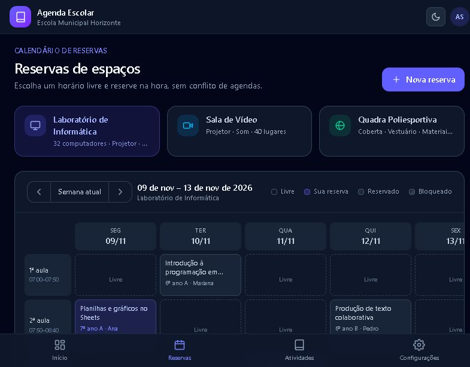
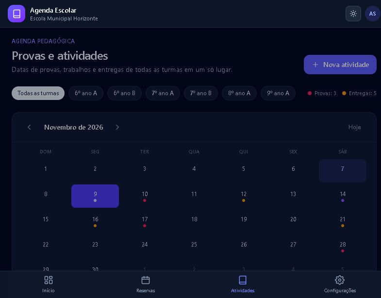

# site-escola

App web para a escola resolver dois problemas em um só lugar:

1. **Reservas de espaços** — calendário digital para reservar o laboratório de informática (e outros espaços) sem conflito de horários.
2. **Provas e atividades** — agenda de provas, trabalhos e entregas com anexos, organizada por turma.

> **Status:** protótipo navegável com dados fictícios. Toda a interface já funciona no navegador; o próximo passo é conectar um banco de dados e login reais.
>
> Planejamento completo: [`PLANEJAMENTO.md`](./PLANEJAMENTO.md) · Roteiro de demonstração: [`docs/PROTOTIPO.md`](./docs/PROTOTIPO.md)

## Prévia

| Reservas de espaços | Provas e atividades |
|---|---|
|  |  |

## Telas

| Rota | Tela | O que faz |
|---|---|---|
| `/` | Início | Próxima reserva, indicadores, agenda da escola e próximas entregas. |
| `/reservas` | Reservas | Calendário semanal por espaço, reserva em 2 cliques, cancelamento, bloqueios da coordenação e ocupação da semana. |
| `/atividades` | Provas e atividades | Calendário mensal, lista de próximas entregas, detalhe com anexos e publicação de nova atividade. |
| `/configuracoes` | Configurações | Prévia do painel da coordenação: espaços, grade de horários, regras e permissões. |

## Como rodar

Requisitos: Node.js 20+ e npm.

```bash
npm install
npm run dev
```

Abra [http://localhost:3000](http://localhost:3000).

Outros comandos:

```bash
npm run lint    # verifica o código
npm run build   # build de produção
npm start       # serve o build
```

> No Windows, se o PowerShell bloquear `npm.ps1`, use `npm.cmd run dev`.

## O que já funciona

- Reserva automática de horário livre com **prevenção de conflito** (o horário fica indisponível na hora).
- Bloqueio de horários pela coordenação (manutenção, reunião) e horários passados desabilitados.
- Cancelamento das próprias reservas.
- Publicação de provas/atividades com data da prova, prazo de entrega e anexos (nome e tamanho).
- Filtro por turma, calendário mensal com marcadores e detalhe da atividade.
- **Modo escuro** com botão de alternância (claro/escuro), aplicado ao calendário, às turmas e a todas as telas; a escolha fica salva no navegador.
- Persistência local no navegador (`localStorage`), então as alterações sobrevivem ao recarregar.
- Layout responsivo: barra lateral no computador, navegação inferior no celular.

## O que é simulado

- **Login e permissões:** existe um usuário fixo (Ana Souza). Não há autenticação real.
- **Dados:** reservas, atividades e turmas são fictícios.
- **Upload:** os arquivos não são enviados; só o nome e o tamanho são guardados.
- **Configurações:** os ajustes da tela de configurações não são salvos.
- **Backend:** não há banco de dados nem API.

## Tecnologia

- [Next.js 16](https://nextjs.org) (App Router) + React 19 + TypeScript
- [Tailwind CSS 4](https://tailwindcss.com)
- Ícones SVG próprios (sem dependência extra)
- Estado global com Context + `localStorage`

## Estrutura

```
src/
├── app/
│   ├── layout.tsx          # layout raiz + provider + shell
│   ├── page.tsx            # painel inicial
│   ├── globals.css         # tema e animações
│   ├── reservas/page.tsx   # calendário de reservas
│   ├── atividades/page.tsx # agenda de provas e entregas
│   └── configuracoes/page.tsx
├── components/
│   ├── app-shell.tsx       # navegação lateral/inferior
│   ├── icons.tsx           # ícones SVG
│   └── ui.tsx              # botões, modal, badges, toast…
├── lib/
│   ├── date.ts             # utilidades de data (pt-BR)
│   ├── mock-data.ts        # espaços, horários, turmas e dados de exemplo
│   └── store.tsx           # estado global + persistência local
└── types/
    └── index.ts            # tipos do domínio
```

## Próximos passos para produção

1. Banco de dados PostgreSQL (Supabase/Neon) com a restrição de unicidade `(espaco, data, horario)`.
2. Login real (Supabase Auth) e perfis professor / aluno / coordenação.
3. Upload de arquivos em storage com limite de tamanho e tipos permitidos.
4. Regras no servidor (cancelamento, bloqueios, permissões) — nunca só na tela.
5. Deploy na Vercel e piloto com 3–5 professores.

Consulte o cronograma e os riscos no [`PLANEJAMENTO.md`](./PLANEJAMENTO.md).
