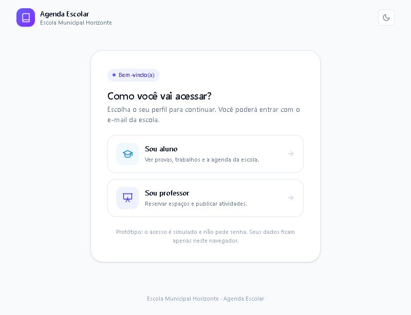

# site-escola

App web para a escola resolver dois problemas em um só lugar:

1. **Reservas de espaços** — calendário digital para reservar o laboratório de informática (e outros espaços) sem conflito de horários.
2. **Provas e atividades** — agenda de provas, trabalhos e entregas com anexos, organizada por turma.

> **Status:** protótipo completo, publicado e com banco de dados PostgreSQL integrado.
>
> 🔗 **Site publicado:** <https://site-escola-1nmy.onrender.com> (plano gratuito do Render: o servidor "dorme" após inatividade e a primeira visita pode demorar até ~50 s)
>
> Planejamento completo: [`PLANEJAMENTO.md`](./PLANEJAMENTO.md) · Roteiro de demonstração: [`docs/PROTOTIPO.md`](./docs/PROTOTIPO.md)

## Prévia

| Login (Aluno ou Professor) | Reservas de espaços | Provas e atividades |
|---|---|---|
|  |  |  |

## Telas

| Rota | Tela | O que faz |
|---|---|---|
| `/` | Login | Escolha entre **Aluno** e **Professor** e entre com a conta Google da escola. A senha é digitada no Google e nunca passa pelo site. A sessão fica salva no navegador. |
| `/` (logado) | Início | Próxima reserva, indicadores, agenda da escola e próximas entregas. |
| `/reservas` | Reservas | Calendário semanal por espaço, reserva em 2 cliques, cancelamento, bloqueios da coordenação e ocupação da semana. |
| `/atividades` | Provas e atividades | Calendário mensal, lista de próximas entregas, detalhe com anexos e publicação de nova atividade. |
| `/configuracoes` | Configurações | Painel da coordenação (somente professor): espaços, grade de horários, regras, permissões e limpeza dos dados. |
| `/privacidade` | Política de Privacidade | Página pública (abre sem login) exigida pelo Google para publicar o login OAuth. |
| `/termos` | Termos de Uso | Página pública (abre sem login) com as regras de uso do app. |

## Como rodar

Requisitos: Node.js 20+ e npm.

```bash
npm install
npm run dev
```

Abra [http://localhost:3000](http://localhost:3000).

Outros comandos:

```bash
npm run lint    # verifica o código
npm run build   # build de produção
npm start       # serve o build
```

### Login com Google (obrigatório)

O app não recebe senhas. O aluno/professor entra com a conta Google da escola e o
Google faz a verificação da senha.

1. Crie um projeto em <https://console.cloud.google.com>;
2. Ative a **Google Identity Services** (também chamada de "Sign in with Google");
3. Crie um **OAuth 2.0 Client ID** do tipo **Web application**;
4. Em **Origens JavaScript autorizadas**, adicione:
   - `http://localhost:3000`
   - `https://site-escola-1nmy.onrender.com`
5. Coloque o Client ID no `.env.local`:
   `NEXT_PUBLIC_GOOGLE_CLIENT_ID="...apps.googleusercontent.com"`;
6. No Render, cadastre a mesma variável `NEXT_PUBLIC_GOOGLE_CLIENT_ID` e faça um novo deploy.

Sem essa variável, a tela de login mostra um aviso de configuração e ninguém
consegue entrar. Os e-mails autorizados ficam em `src/lib/access.ts`:
professores em `REGISTERED_TEACHERS` e alunos em `REGISTERED_STUDENTS`.

### Banco de dados (PostgreSQL no Neon)

Sem configuração, os dados ficam só no navegador (`localStorage`). Para usar o
banco (o app já está preparado para isso):

1. Crie um banco grátis em <https://neon.com> e copie a connection string;
2. Crie o arquivo `.env.local` (veja o exemplo em `.env.example`) com
   `DATABASE_URL="postgresql://…?sslmode=require"`;
3. Reinicie o app. As tabelas (`reservas`, `atividades`, `bloqueios`) são criadas
   automaticamente e todos os usuários passam a ver os mesmos dados;
4. No Render, configure a mesma variável `DATABASE_URL` nas opções do serviço.

> No Windows, se o PowerShell bloquear `npm.ps1`, use `npm.cmd run dev`.

## O que já funciona

- **Login com Google em duas etapas:** primeiro escolha **Aluno** ou **Professor**, depois entre com a conta Google da escola. A senha é digitada no Google e o servidor valida o token; somente os e-mails cadastrados em `src/lib/access.ts` podem entrar. A sessão fica salva no navegador.
- **Permissões por perfil:** professores podem reservar espaços, cancelar reservas, publicar e excluir atividades e abrir as configurações; alunos têm acesso somente leitura e não veem Configurações.
- **App começa vazio:** sem reservas, atividades ou bloqueios de exemplo. Tudo o que aparece é criado pelos usuários.
- Reserva automática de horário livre com **prevenção de conflito** (o horário fica indisponível na hora).
- Bloqueio de horários pela coordenação (manutenção, reunião) e horários passados desabilitados.
- Cancelamento das próprias reservas.
- Publicação de provas/atividades com data da prova, prazo de entrega e anexos (nome e tamanho).
- Filtro por turma, calendário mensal com marcadores e detalhe da atividade.
- **Modo escuro** com botão de alternância (claro/escuro), aplicado ao calendário, às turmas, ao login e a todas as telas; a escolha fica salva no navegador.
- Persistência local no navegador (`localStorage`), então a sessão e as alterações sobrevivem ao recarregar.
- Layout responsivo: barra lateral no computador, navegação inferior no celular.
- **Tema do colégio (preto e verde):** botão com o mascote do CEPK ao lado do botão claro/escuro; ativa o modo escuro com o verde do Colégio Estadual Presidente Kennedy.
- **PWA instalável:** `manifest.json` + Service Worker (`public/sw.js`); o app pode ser instalado no celular pelo botão "Instalar aplicativo" (menu lateral e Configurações) e abre em tela cheia, sem barra do navegador.
- **Foto do colégio** na tela de login (ilustração da entrada do CEPK em `public/escola-cepk.svg`).

## O que é simulado

- **Login e permissões:** o acesso é feito pelo **Google** e a senha nunca passa por este site. O servidor valida o token do Google e libera o perfil de **professor** apenas para os e-mails de `REGISTERED_TEACHERS` e o de **aluno** apenas para os e-mails de `REGISTERED_STUDENTS`, ambos em `src/lib/access.ts`. Os demais recebem a mensagem para falar com a coordenação. O nome exibido vem da conta Google.
- **Dados:** não há dados de exemplo. Reservas e atividades são criadas pelos usuários e ficam apenas neste navegador.
- **Upload:** os arquivos não são enviados; só o nome e o tamanho são guardados.
- **Configurações:** os ajustes da tela de configurações não são salvos (só a limpeza dos dados funciona).
- **Backend:** não há banco de dados nem API.

## Tecnologia

- [Next.js 16](https://nextjs.org) (App Router) + React 19 + TypeScript
- [Tailwind CSS 4](https://tailwindcss.com)
- Ícones SVG próprios (sem dependência extra)
- Estado global com Context + `localStorage`

## Estrutura

```
src/
├── app/
│   ├── layout.tsx          # layout raiz + provider + shell
│   ├── page.tsx            # painel inicial
│   ├── globals.css         # tema e animações
│   ├── reservas/page.tsx   # calendário de reservas
│   ├── atividades/page.tsx # agenda de provas e entregas
│   └── configuracoes/page.tsx
├── components/
│   ├── app-shell.tsx       # navegação lateral/inferior e perfil
│   ├── auth-gate.tsx       # alterna login e app conforme a sessão
│   ├── login-screen.tsx    # login em duas etapas (perfil + conta Google)
│   ├── icons.tsx           # ícones SVG
│   └── ui.tsx              # botões, modal, badges, toast…
├── lib/
│   ├── date.ts             # utilidades de data (pt-BR)
│   ├── mock-data.ts        # espaços, horários e turmas (sem dados de exemplo)
│   └── store.tsx           # estado global, sessão e persistência local
└── types/
    └── index.ts            # tipos do domínio
```

## Próximos passos para produção

1. Banco de dados PostgreSQL (Supabase/Neon) com a restrição de unicidade `(espaco, data, horario)`.
2. Login real (Supabase Auth) e perfis professor / aluno / coordenação.
3. Upload de arquivos em storage com limite de tamanho e tipos permitidos.
4. Regras no servidor (cancelamento, bloqueios, permissões) — nunca só na tela.
5. Deploy na Vercel e piloto com 3–5 professores.

Consulte o cronograma e os riscos no [`PLANEJAMENTO.md`](./PLANEJAMENTO.md).
