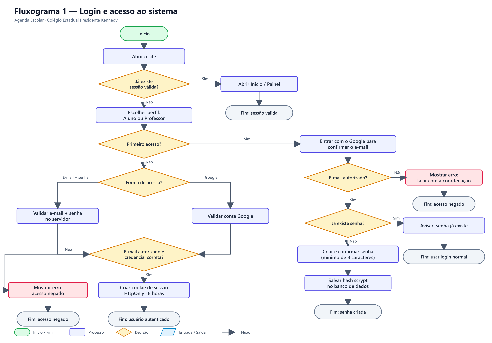
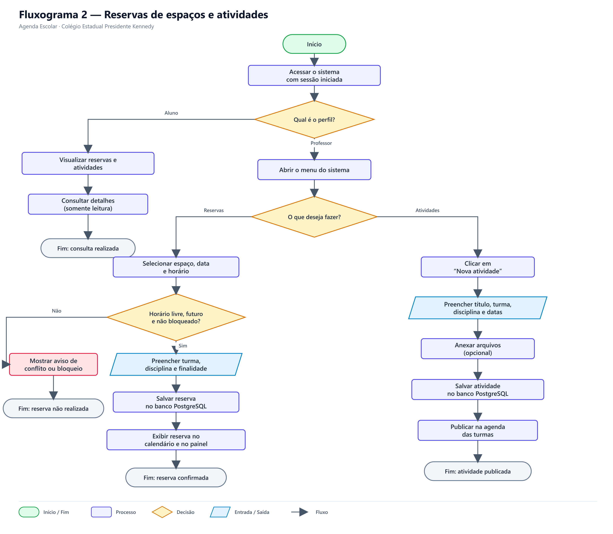
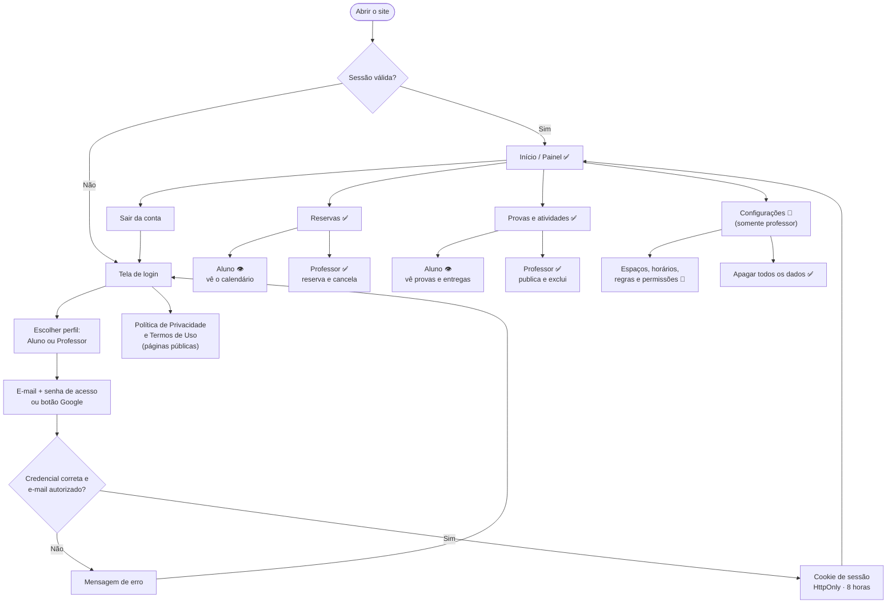
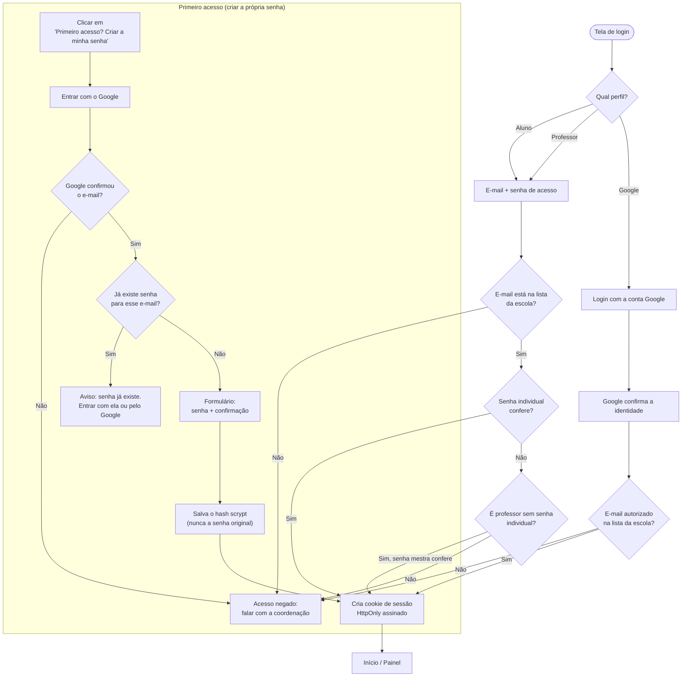
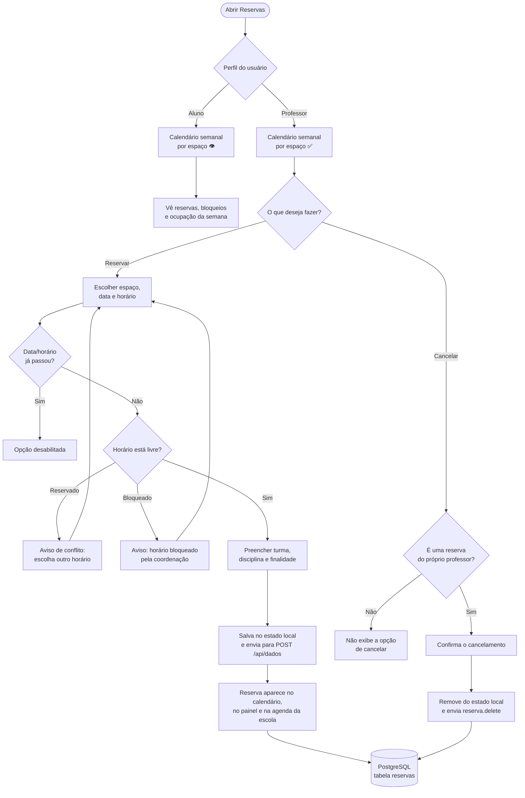
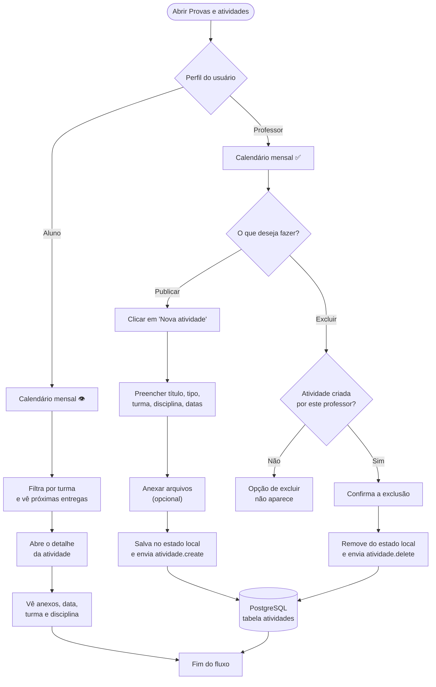
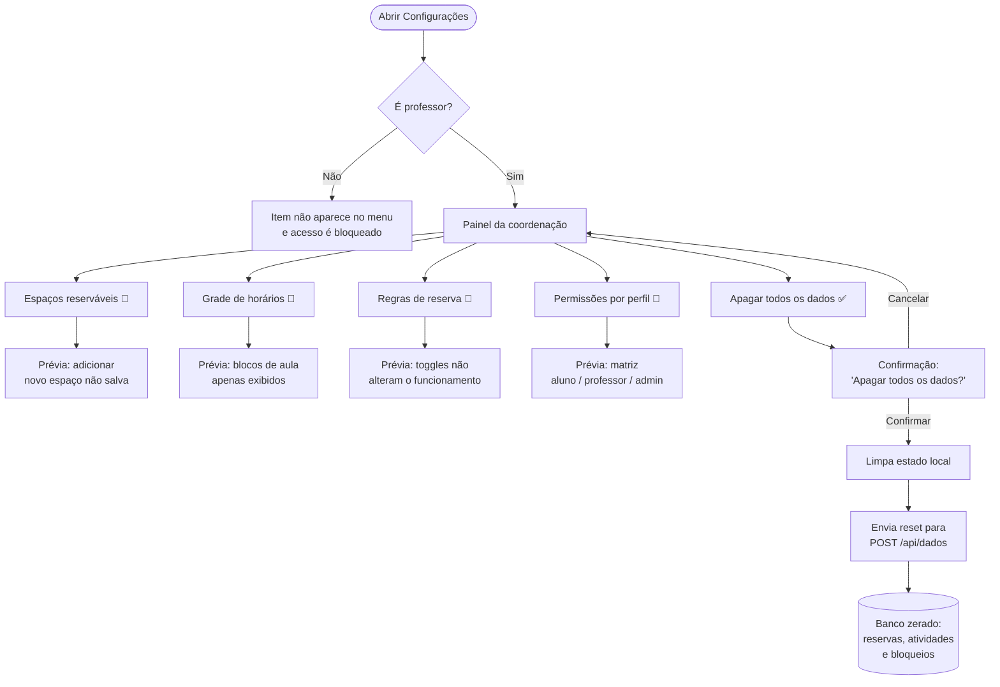
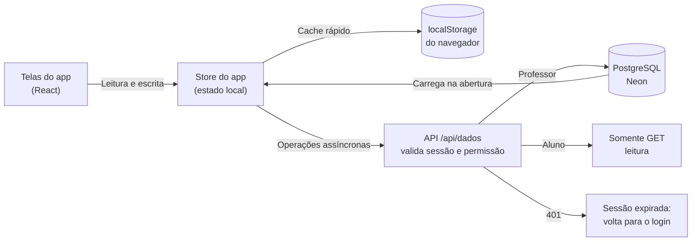

# Fluxograma do site

Mapa dos caminhos que o usuário percorre no **Agenda Escolar** e das regras de
permissão aplicadas em cada etapa. Os diagramas usam **Mermaid** e são
renderizados automaticamente pelo GitHub.

> Legenda dos status usados no documento:
>
> - ✅ **Funcional** — grava ou consulta dados de verdade.
> - 👁️ **Somente leitura** — aluno visualiza, mas não altera.
> - 🧪 **Prévia** — tela de demonstração, ainda não salva alterações.

## Fluxogramas em imagem

Os dois fluxogramas abaixo foram desenhados com os **símbolos corretos de
fluxograma**: elipse para **início/fim**, retângulo para **processo**, losango
para **decisão**, paralelogramo para **entrada/saída** e setas para indicar o
**fluxo**. Todos os caminhos têm início, fim e as saídas **Sim/Não** das
decisões.

### 1. Login e acesso ao sistema

### 2. Reservas de espaços e atividades

Arquivos em tamanho original: [`docs/fluxogramas/`](./fluxogramas).

Os diagramas Mermaid abaixo repetem o mesmo conteúdo em formato de texto,
para facilitar a leitura e a edição.

---

## 1. Visão geral: da entrada até cada tela

---

## 2. Login, primeiro acesso e sessão

**Regras importantes**

- Ninguém pode cadastrar o e-mail de outra pessoa: a senha própria só é criada
  depois que o **Google confirma** que a conta pertence àquele e-mail.
- A rota de criação **nunca sobrescreve** uma senha existente.
- A senha do Google é digitada **no Google** e nunca passa pelo site.
- Limite de tentativas por IP e por e-mail (proteção contra força bruta).
- Se o e-mail sair da lista da escola, a sessão deixa de valer na próxima
  requisição.

---

## 3. Reservas de espaços

**Regras importantes**

- Só **professores** reservam, cancelam e veem o botão de ação.
- **Aluno** é somente leitura.
- Não é possível reservar no passado, em horário ocupado ou bloqueado.
- O servidor revalida a permissão: mesmo burlando a interface, o aluno recebe
  `403` ao tentar criar dados.

---

## 4. Provas e atividades

---

## 5. Configurações e permissões

**Matriz de permissões aplicada no servidor**

| Ação | Aluno | Professor |
|---|:---:|:---:|
| Ver reservas e atividades | ✅ | ✅ |
| Reservar / cancelar horários | ❌ | ✅ |
| Publicar / excluir atividades | ❌ | ✅ |
| Bloquear horários (coordenação) | ❌ | ✅ |
| Apagar todos os dados | ❌ | ✅ |

---

## 6. Persistência dos dados

**O que fica salvo no banco**

| Tabela | Conteúdo |
|---|---|
| `reservas` | Reservas de espaços feitas pelos professores |
| `atividades` | Provas, trabalhos e entregas |
| `bloqueios` | Horários bloqueados pela coordenação |
| `senhas` | Hash scrypt da senha individual de cada pessoa |

Sem `DATABASE_URL`, o app usa o `localStorage` e um armazenamento em memória no
servidor — útil para demonstração, mas os dados não sobrevivem a um reinício.

---

## 7. Resumo das rotas

| Rota | Acesso | Função |
|---|---|---|
| `/` | Público / logado | Login ou painel inicial |
| `/reservas` | Logado | Calendário e reservas de espaços |
| `/atividades` | Logado | Provas, trabalhos e entregas |
| `/configuracoes` | Professor | Painel da coordenação |
| `/privacidade` | Público | Política de Privacidade |
| `/termos` | Público | Termos de Uso |
| `/api/auth/senha` | Público | Login com e-mail + senha |
| `/api/auth/google` | Público | Login com Google |
| `/api/auth/session` | Logado | Consulta a sessão atual |
| `/api/auth/logout` | Logado | Encerra a sessão |
| `/api/usuarios/minha-senha` | Logado | Consulta / cria a própria senha |
| `/api/dados` | Logado | Leitura e escrita dos dados do app |

---

Voltar para o [README](../README.md).
